<p align="center">
  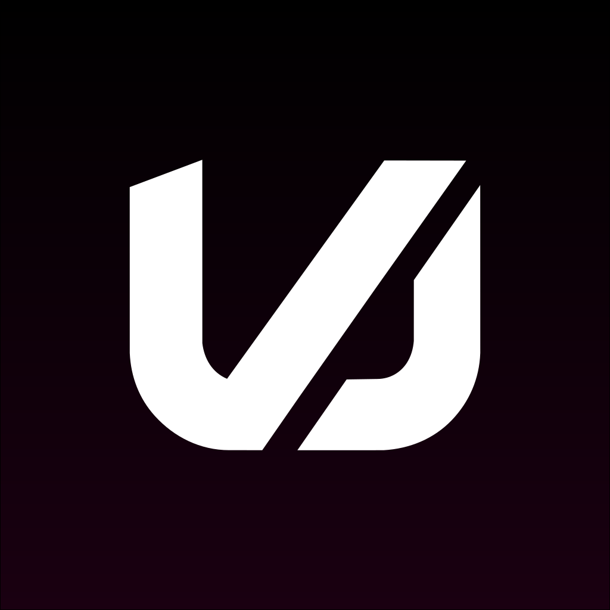
</p>

<h1 align="center">Ultimate VJ</h1>

<p align="center"><strong>Live video mixing and generative visuals. Native macOS. Free.</strong></p>

<p align="center">
  <a href="#install">Install</a> ·
  <a href="https://github.com/weswalz/ULTIMATEVJ-releases/releases">Downloads & release notes</a> ·
  <a href="#technical-overview">Technical overview</a> ·
  <a href="https://github.com/weswalz/ULTIMATEVJ-releases/issues">Report an issue</a>
</p>

Ultimate VJ is a visual performance application for Apple Silicon. It combines a bank-and-layer clip launcher, GPU compositing, ordered effect chains, editable text, and a canonical free catalog of 28 RenderWave generators in one console. Available shaders depend on the catalog supplied with your build. Mix recorded footage with procedural sources, control the composition from MIDI or the keyboard, and send the result to a separate output display.

**Alpha — installation and evaluation.** Full four-hour triggering soak, production workload performance, and physical venue-output acceptance remain pending. Test your intended machine and display setup, and install updates between shows. This repository distributes binaries and documentation; application and RenderWave source code are not published here.

Developed and maintained by [Wes Walz](https://github.com/weswalz). Free to use, with no account or licence key required.

## Install

Requires **Apple Silicon** and **macOS 26 Tahoe or later**.

```sh
brew update
brew tap weswalz/ultimatevj
brew install --cask weswalz/ultimatevj/ultimatevj
```

For a manual installation, download the arm64 ZIP from [Releases](https://github.com/weswalz/ULTIMATEVJ-releases/releases), extract it, and move `ULTIMATEVJ.app` into Applications. Public builds are Developer ID signed and Apple notarized; each release includes a SHA-256 checksum file.

**Alpha:** test your set on the machine and display you intend to use, and install updates between shows. See [Alpha scope](#alpha-scope) for the current boundaries.

## Performance console

| Area | Capabilities |
| --- | --- |
| Clip performance | Banks, layers, column triggering, cue points, playback speed, and clip transitions. |
| Compositing | Layer blend modes, opacity, A/B crossfader assignment, and nested layer groups. |
| Effects | 27 built-in effects, with ordered stacks at clip, layer, group, and master scope. Up to 16 effect instances per scope. |
| Generative sources | Canonical free catalog of 28 RenderWave generators with editable controls and saved clip settings; availability depends on the supplied build catalog. |
| Text | Editable text clips with font, colour, alignment, and scale animation. |
| Control and sync | Learned keyboard mappings, MIDI Note/CC mappings, and Ableton Link tempo and bar-phase sync. |
| Output | Clean fullscreen or windowed output, selectable composition dimensions, and silent video recording. |
| Sets and recovery | Saved `.uvj` sets, autosave, recovery copies, and set recovery across in-app updates. |

The effect collection includes feedback, trails, frame delay, freeze, displacement, wave warp, RGB split, luma key, cloning, and kaleidoscope processing. Effect order is explicit: each stage receives the result of the preceding stage.

### RenderWave, built in

RenderWave sources generate frames on the GPU rather than playing a pre-rendered loop. Their controls and saved looks belong to the clip, so generated visuals can be arranged and processed alongside imported media.

<table>
  <tr>
    <td width="50%" align="center"><a href="assets/renderwave/brass-tempest-4k.png">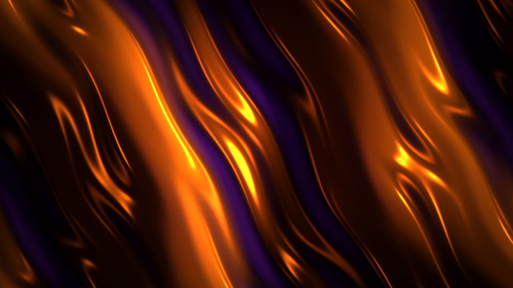</a><br><strong>Brass Tempest</strong></td>
    <td width="50%" align="center"><a href="assets/renderwave/hypnotizer-4k.png">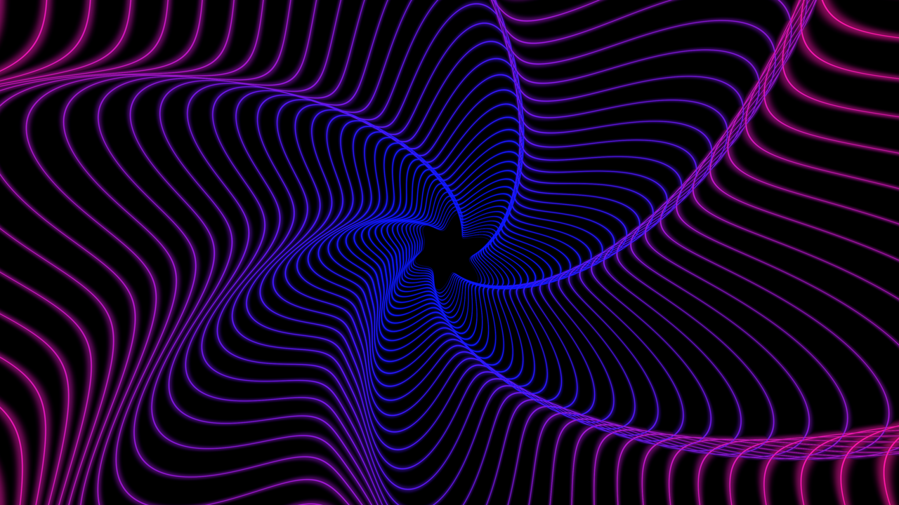</a><br><strong>Hypnotizer</strong></td>
  </tr>
  <tr>
    <td width="50%" align="center"><a href="assets/renderwave/crop-circles-v2-4k.png">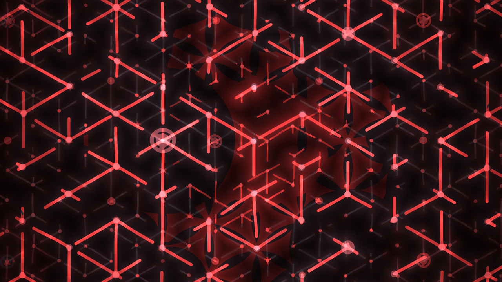</a><br><strong>Crop Circles V2</strong></td>
    <td width="50%" align="center"><a href="assets/renderwave/neon-wave-4k.png">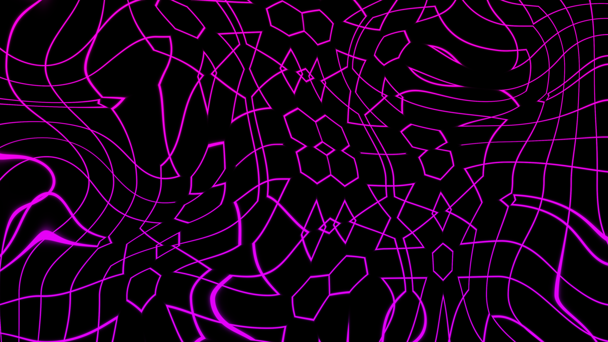</a><br><strong>Neon Wave</strong></td>
  </tr>
  <tr>
    <td width="50%" align="center"><a href="assets/renderwave/neural-constellation-4k.png">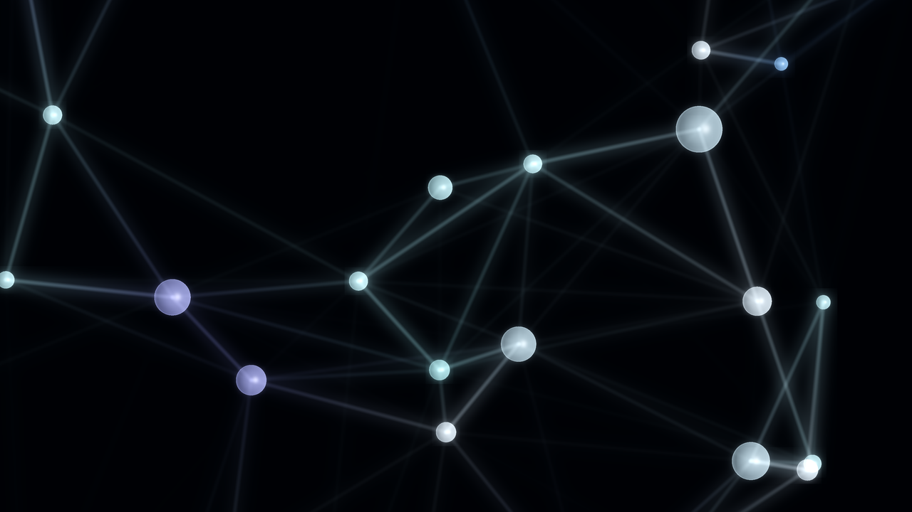</a><br><strong>Neural Constellation</strong></td>
    <td width="50%" align="center"><a href="assets/renderwave/megalasers-4k.png">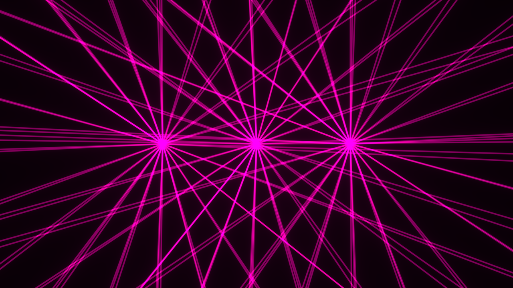</a><br><strong>MEGALASERS</strong></td>
  </tr>
  <tr>
    <td width="50%" align="center"><a href="assets/renderwave/grid-zoom-sandwich-v4-4k.png">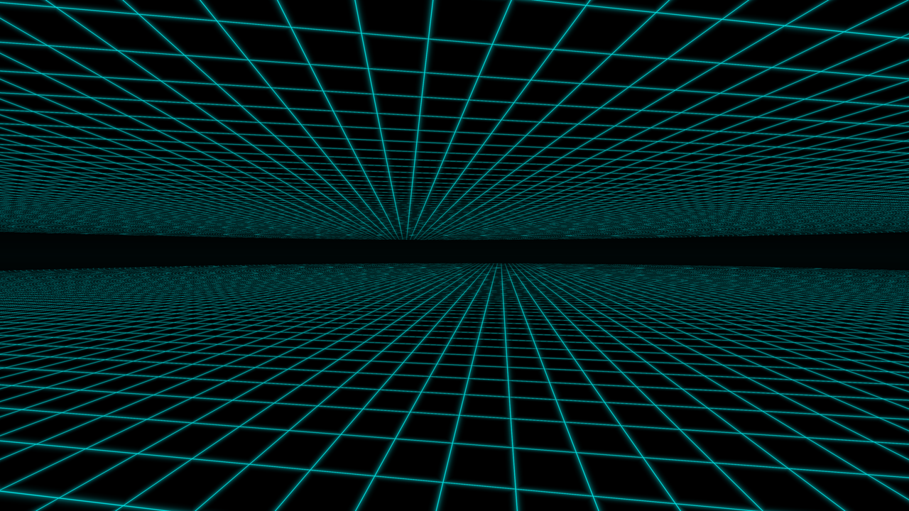</a><br><strong>The Grid</strong></td>
    <td width="50%" align="center"><a href="assets/renderwave/matrix-rain-3d-v3-4k.png">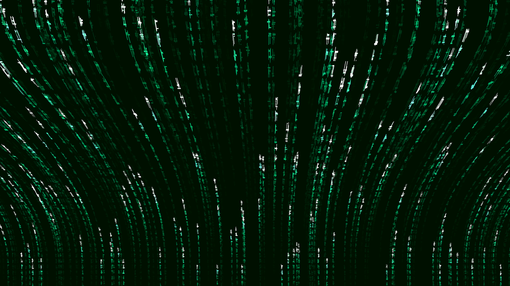</a><br><strong>Matrix Rain 3D V3</strong></td>
  </tr>
  <tr>
    <td width="50%" align="center"><a href="assets/renderwave/phantom-sigils-4k.png">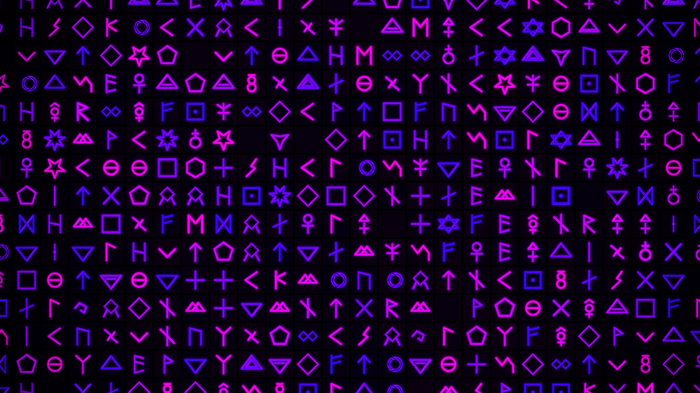</a><br><strong>Phantom Sigils</strong></td>
    <td width="50%" align="center"><a href="assets/renderwave/kaleido-flux-4k.png">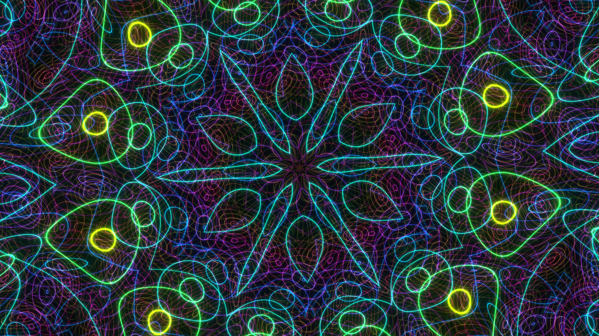</a><br><strong>Kaleido Flux</strong></td>
  </tr>
  <tr>
    <td width="50%" align="center"><a href="assets/renderwave/galactic-saturn-4k.png">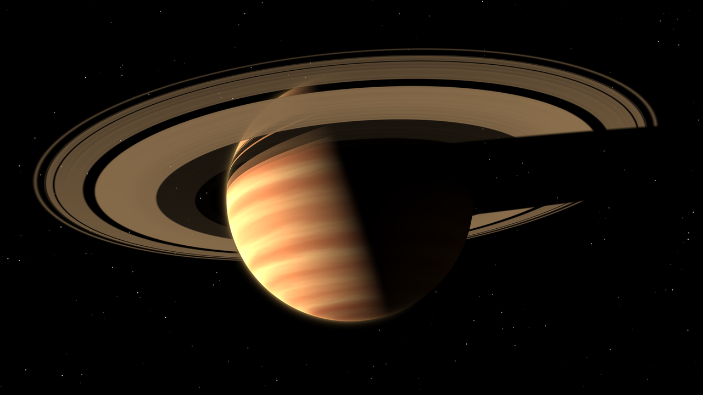</a><br><strong>GALACTIC SATURN</strong></td>
    <td width="50%" align="center"><a href="assets/renderwave/disco-lines-4k.png">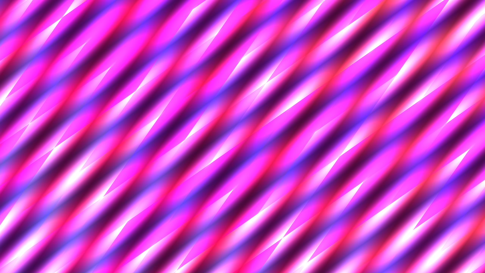</a><br><strong>Disco Lines</strong></td>
  </tr>
</table>

<p align="center"><sub>Native 3840 × 2160 renders using the RenderWave shaders shipped in Ultimate VJ 0.2.4 (13), with selected control settings. Click an image to open its lossless 4K PNG.</sub></p>

## Technical overview

The application is written in **Swift**, with **SwiftUI and AppKit** for the desktop interface. The rendering pipeline uses **Metal and Core Image**; procedural sources run through the compiled RenderWave runtime. Media decoding uses **AVFoundation and bundled FFmpeg**.

Clip processing feeds layer processing, optional group stages, and then the master stage. Each effect scope has its own ordered stack. Off-air clip audition has an independent preview playhead; the performance output remains a separate view.

**Ableton Link** synchronizes tempo and bar phase. MIDI input handles Note On, Note Off, and Control Change. Optional runtime debugging records renderer timing, errors, and recent history and exports a local Markdown report for diagnosis.

## Updates

For a Homebrew installation, quit Ultimate VJ and run:

```sh
brew update
brew upgrade --cask weswalz/ultimatevj/ultimatevj
```

The Homebrew-managed app also provides **Settings → Updates → Check for Updates** and **Update and Restart**. Checking and installation are separate actions. Installation saves a recovery set, waits for the app to quit, updates through Homebrew, verifies the installed version and Developer ID signature, and relaunches with the saved set. Recording must be stopped before installation.

The [official tap](https://github.com/weswalz/homebrew-ultimatevj/blob/main/Casks/ultimatevj.rb) specifies the version, archive URL, and checksum. App archives are hosted in this repository's release assets.

## Alpha scope

The current build supports one selected physical output display at a time. Experimental Syphon input and output exist in development source; availability and qualification in the downloaded package remain unverified. NDI and third-party FFGL/ISF plug-in hosting are not implemented. Ableton Link does not synchronize transport start/stop. Video recordings contain no audio. Sustained frame rate depends on the workload and has not been qualified for production use.

This is the public binary distribution repository. Application and RenderWave source code are not published here.

## Feedback

[Open an issue](https://github.com/weswalz/ULTIMATEVJ-releases/issues/new) with the app version and build, Mac model, macOS version, steps to reproduce, and expected versus observed behaviour. For rendering problems, include the composition size and output configuration. A runtime report is useful; review it for private information before attaching it. Never attach venue media or credentials.
